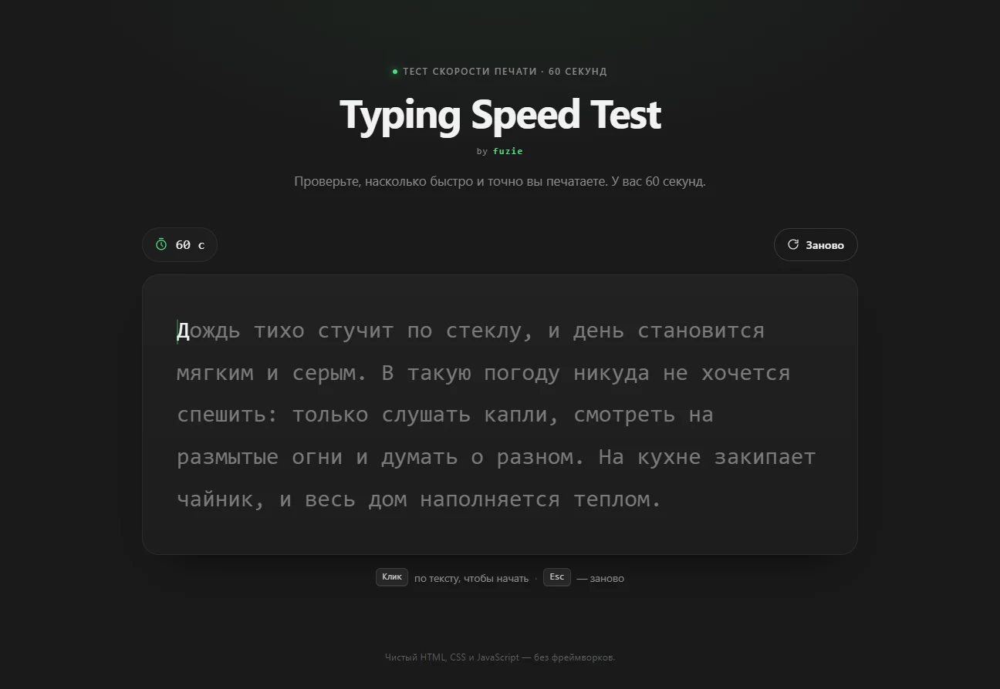

# Typing Speed Test — by fuzie

Минималистичный тест скорости печати на **60 секунд**. Чистый HTML, CSS и
Vanilla JavaScript: без фреймворков, зависимостей и сборки.

[](https://fuzieswagger.github.io/typing-speed-test/)
[](#)
[](#)
[](#)
[](LICENSE)

[**Открыть демо →**](https://fuzieswagger.github.io/typing-speed-test/)

[](https://fuzieswagger.github.io/typing-speed-test/)

## Возможности

- **60 секунд на печать.** Таймер запускается с первой набранной клавиши,
  а последние 10 секунд подсвечиваются красным.
- **Живая подсветка.** Правильные символы становятся зелёными, ошибки —
  красными и подчёркнутыми.
- **Скорость и точность.** После теста показываются WPM, точность и время.
- **Случайные тексты.** Четыре русских отрывка; при повторе выбирается новый.
- **Автопрокрутка.** Видно пять строк, текущая строка всегда остаётся на экране.
- **Две раскладки.** Можно печатать в русской или английской раскладке —
  символы сопоставляются по физическим клавишам.
- **Аккуратный финиш.** Ввод блокируется, результаты появляются под текстом.
- **Адаптивность.** Работает на десктопе и телефоне, уважает
  `prefers-reduced-motion`.

## Как играть

1. Кликните по тексту — поле ввода активируется.
2. Начните печатать. С первого символа запускается таймер.
3. Печатайте как можно быстрее и точнее, следя за подсветкой ошибок.
4. Через 60 секунд (или после набора всего текста) появится результат.

| Действие | Что делает |
| --- | --- |
| Клик по тексту | Активирует поле ввода |
| Любая клавиша | Запускает таймер при первом вводе |
| `Esc` | Начинает тест заново |
| «Заново» | Новый текст, сброс таймера и результатов |
| «Попробовать снова» | То же самое из блока результатов |

## Как считаются метрики

- **WPM (слов в минуту):** `(правильные символы / 5) / (время в минутах)`.
  Пять символов условно считаются одним словом.
- **Точность:** `(правильные символы / всего введённых символов) × 100%`.
- **Время:** фактически прошедшее время теста, но не больше 60 секунд.

## Технологии

- **HTML5** — семантическая разметка, ARIA-атрибуты.
- **CSS3** — кастомные свойства, Grid/Flexbox, анимации, адаптив.
- **Vanilla JavaScript** — состояние теста, таймер, подсчёт статистики,
  поддержка раскладок, автопрокрутка. Без библиотек.

## Структура проекта

```
.
├── assets/
│   ├── favicon.svg      # иконка сайта
│   └── preview.webp     # превью для README
├── index.html           # разметка интерфейса
├── style.css            # тёмная тема, анимации, адаптивность
├── script.js            # тексты, таймер, статистика, рестарт
├── LICENSE              # MIT
└── README.md
```

## Запуск локально

Сборка не нужна — достаточно открыть `index.html` в браузере.

Если хочется запустить через локальный сервер:

```bash
# Python 3
python -m http.server 8000

# или Node.js
npx serve .
```

Затем откройте `http://localhost:8000`.

## Дизайн

| Токен | Значение | Назначение |
| --- | --- | --- |
| `--bg` | `#1a1a1a` | фон страницы |
| `--surface` | `#202020` | карточки |
| `--accent` | `#4ade80` | правильные символы, акценты |
| `--error` | `#ef4444` | ошибки, последние секунды |

Крупный моноширинный текст, мягкое свечение карточки при фокусе, плавные
появления и мигающая каретка.

## Лицензия

[MIT](LICENSE) © 2026 fuzie
